# 検証結果

## 2026-10-20 外出のストレス0・嫌な瞬間でストレス

- `make lint` 成功。`make test` はpytest 5件、Godot 6,580チェック成功。
- 出かけること・章の開始でストレスが動かないこと、嫌な瞬間の行（例：歩道橋の「もう男ではない」で +5）を読み終えた時にだけ上がり、同じ行を再開しても重ならないことを検証。16か所はすべて寄り道か本編の途中の行で、最後の行（気づきの±1）には重ねていない。
- 3方針の通しプレイ：最終ストレス 68〜76（素）、EXP合計 368〜478。
- GitHub Pages [公開処理39404026944](https://github.com/xemonodesign/godot-novel-yodaka/actions/runs/39404026944) 成功（gh-pages 378b041、この検証と同じコードのビルド）。公開URLはこの作業環境から到達できないため、配信物の一致は未確認。
- Chromium（Playwright、`build/web` をローカル配信）で通しプレイを完走：自由行動12回（訪問7か所＋休息5回）・本編4章・セッション4回で謎を4つ開き、受け取った言葉4（留めた2・手放した2）、カルテ2回、結果画面、再読み込み後の「つづきから」で結果画面を復元。最終ステータス [61, 9, 13, 15]、EXP 216（合計396）。シード保存の検証（受け取りの選択、チュートリアル、ストレス76の外出制限、勇気の上限、盤面での向き合いと強化）も通過。JavaScript / Godot実行時エラー0件。

## 2026-10-20 3状態のトラウマ・夜の削除・画面の文字削減

- `make lint` 成功。`make test` はpytest 5件・カバレッジ86%、Godot 5,662チェック成功。
- 棚は謎のトラウマ6つ＋空き2枠で開始し、表示は `[64, 5, 5, 4]`。3方針の通しプレイ（状態のみ）：寄り道12回・章4つ・セッション4回で謎を4つ開き、受け取った言葉4、EXP合計 348〜472。夜が無いので日が終わると直接 MAP／章／セッションへ進み、章の開始でストレス+6だけが乗ることを検証。
- 3状態：謎（ストレス+4・勇気上限12・キラキラ25%減）→ 鑑定済み（+12・上限5・半減）→ 受け入れ（消える）。「〜が半分」の3つは棚にある限り有効。向き合うEXP ＝ 元の量 × 持っている言葉の割引（同じ種類は2回）：「女王」で 1,500 → 375、「付き合ってあげる」を足して 188、Lv3の「奇跡」で「もう男じゃないんだし」20,000 → 200。
- セッション：開くのはEXP払いで1回まで、向き合うのは盤面でEXPが足りるときだけ、カウンセリング以外では開けも向き合えもしない。保存v6の復元、v5以前の拒否。
- UI：タイトルは「よだか ガールズモード（仮）」「プロト体験版」のみ。輪郭パネルの「カルテ ▸」を外してEXPを大きく表示。棚はツールチップ・番号・強さの数字なし、謎は赤紫のマダラ（6枚）、鑑定済みは結晶と言葉。場所の切り替えは上枠（`FRAME`）だけが暗くなり棚は見えたまま。カルテは4指標と地図だけ。最初のセッションは診察室の会話のまま棚がハイライトされ、マウスオンで「話してみる？（EXP 20）」、クリックで開いて結晶が現れる。鑑定済みのマウスオンで「向き合う？（EXP 375）」、クリックで向き合ってよだか・みなとの会話。言葉のマウスオンで「強化する？（EXP 80）」、クリックで Lv2 の受け取り方 → Lv3 の気づき。
- 本文領域：台本全文・トラウマの会話（回想・受け止め・向き合い・返し）・気づき・返答がすべて収まることを検証。
- Xvfb上のGodotで16画面を描画して確認（タイトル・上枠だけの暗転・最初のセッション・謎のプレビュー・開いた結晶・鑑定済みのプレビュー・MAP・受け取り・謎のカード・カルテ・向き合うプレビューと会話・言葉のプレビューと強化・結果）。
- Chromium（Playwright、`build/web` をローカル配信）で通しプレイを完走：自由行動12回（訪問6か所＋休息6回。夜の回復が無いのでストレスで休息が増える）・本編4章・セッション4回で謎を4つ開き、受け取った言葉4（留めた2・手放した2）、カルテ2回、結果画面、再読み込み後の「つづきから」で結果画面を復元。最終ステータス [70, 9, 13, 14]、EXP 214（合計394）。シード保存で、取得時の選択の必須化と満杯時の手放し（割引トラウマで15）、チュートリアルの効果、ストレス76が80と判定されて外出できないこと、勇気15が謎の上限12で止まり「もう男じゃないんだし」を受け入れると通ること、盤面で「女王」「付き合ってあげる」を持って「バイト仲間じゃん？」に 188 で向き合い、続けて「女王」を Lv2 に強化して受け取り方を選ぶ（適用差分 [0, 6, 0, 6]）ことを確認。JavaScript / Godot実行時エラー0件。作業環境の再起動で途中中断が2回あり、テスト側のクリック間隔を保存の反映待ちに直して完走。
- GitHub Pages [公開処理39350230112](https://github.com/xemonodesign/godot-novel-yodaka/actions/runs/39350230112) 成功（gh-pages 5b1700e、この検証と同じコードのビルド）。公開URLはこの作業環境から到達できないため、配信物の一致は未確認。

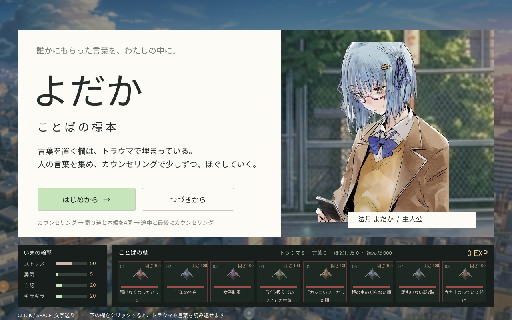

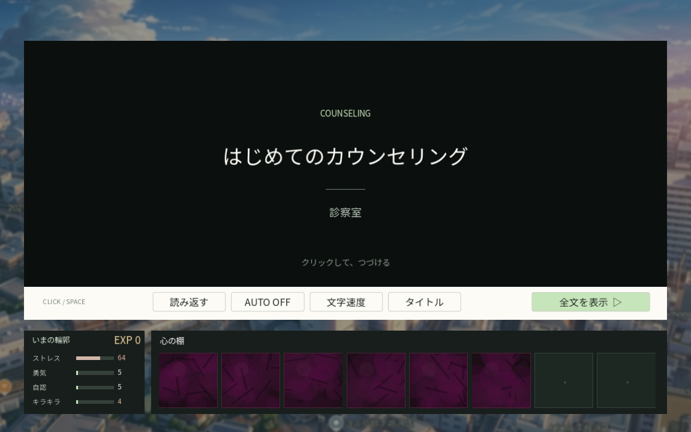

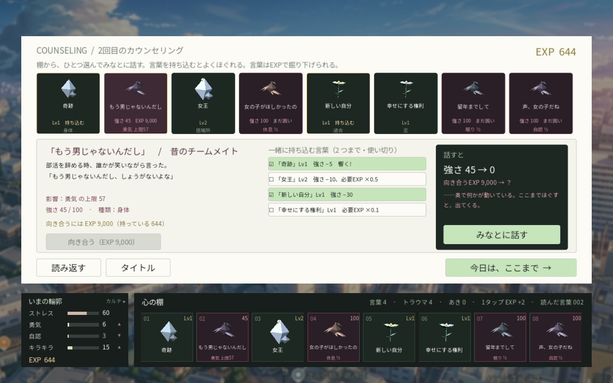

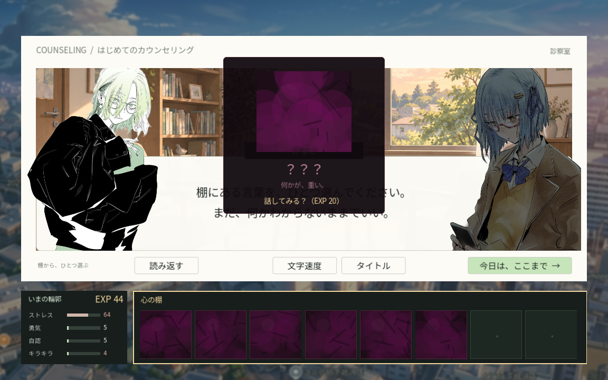

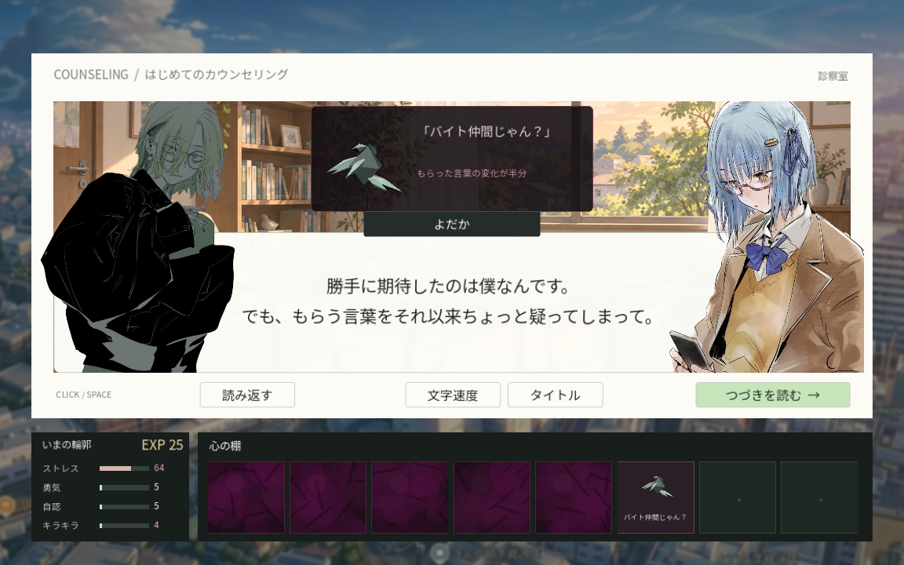

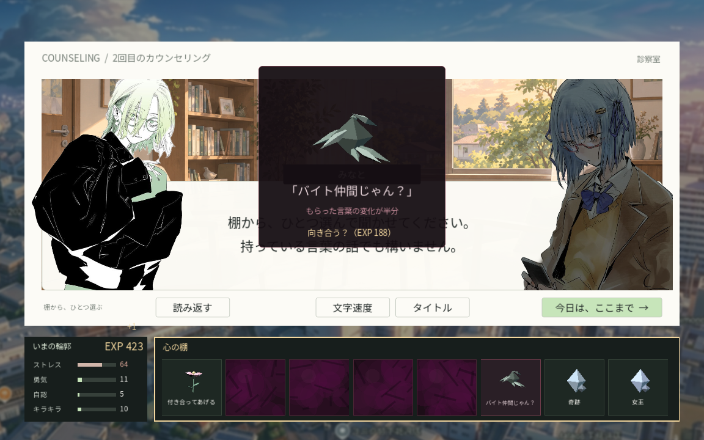

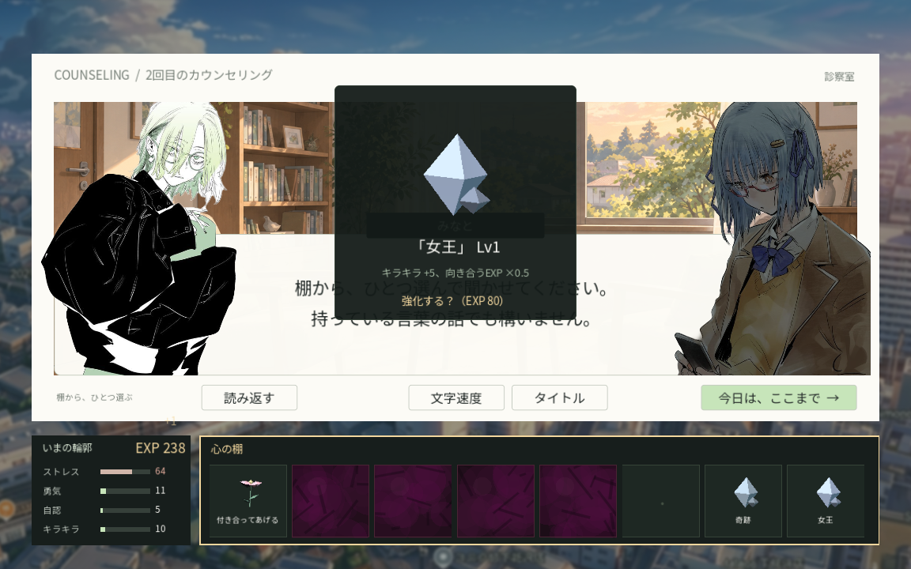

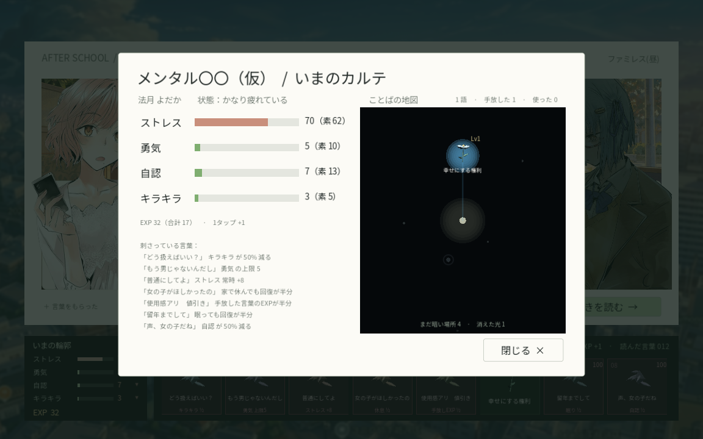

## 2026-10-19 心の棚・トラウマ・EXP・4回のカウンセリング

- `make lint` 成功（Ruff、Godot 4.6.2の読み込み）。`make test` はpytest 5件・カバレッジ86%、Godot 5,305チェック成功。
- 3方針の通しプレイ（状態のみ）：寄り道12回・章4つ・セッション4回（1回目の最初のひとつは必要EXP 30で向き合える、2〜4回目は言葉を0〜2枚持ち込む、方針2は言葉を掘り下げる）。結果は「受け取った言葉4〜6、向き合ったトラウマ1〜2、EXP合計 477〜932、タップ 287〜303」。
- デバフ：初期表示 `[68, 5, 3, 3]`（ストレス+8・勇気の上限5・自認とキラキラ半減）、強さを半分にすると比例して弱まり「〜が半分」の4つは消えること、休息 -15 → -8、眠り -4 → -2、言葉の即時効果が半分、手放すEXPが半分、ストレス72が80と判定されて外出できないこと、勇気15が上限5で止まり「もう男じゃないんだし」を消すと通ることを検証。
- 言葉：もらった時に「心に留める」（空き枠へ）「手放す」「入れ替える」の3通り、Space/Escape/背景クリックでは閉じないこと、保存に未決定の言葉が残ること。持っている言葉の勇気+・EXP×10・手放すEXP×20（自分の手放しには掛からない）の重なり、Lv3の「奇跡」で1タップ10EXP。
- カウンセリング：話す予告と結果の一致、響く言葉の2倍、持ち込んだ言葉の使い切り、1セッション1回、最初のセッションは奥のある言葉を選べないこと、強さ30以下で「本当は、自分でもそう思ってる」（強さ150・200,000）が同じ枠に出ること、Lv2の受け取り方とLv3の気づき、向き合いで枠が空くこと、セッション後に MAP／総括後に結果へ進むこと、保存復元。
- 本文領域：台本全文・トラウマの会話（持ち込んだ言葉の一文を足した状態）・気づき・返答がすべて収まることを検証。
- Xvfb上のGodotでタイトル・最初のセッション・ほぐす演出・向き合い・MAP・受け取り（空きあり／満杯）・トラウマと言葉のカード・カルテ・夜・2回目のセッション（持ち込み・掘り下げ・奥からの出現）・結果の20画面を描画して確認。
- Chromium（Playwright、`build/web` をローカル配信）で通しプレイを完走：自由行動12回・夜16回・セッション4回（各回でトラウマを話す、最初のひとつと向き合う、言葉を留める／手放す）、本編4章、カルテ2回、結果画面、再読み込み後の「つづきから」で結果画面を復元。シード保存で、取得時の選択の必須化、チュートリアルの効果とEXP+1、ストレス72での外出制限、勇気15が上限で止まり「もう男じゃないんだし」を消すと通ること、盤面で「奇跡」を持ち込んで強さ100→70・言葉の使い切りを確認。続けて盤面で「女王」を Lv2 に掘り下げ、受け取り方を選んで返答に進むことを確認（適用差分 [0, 6, 0, 6]）。通しプレイの最終状態：訪問先9か所＋休息3回、受け取った言葉4（留めた3・手放した1）、話したトラウマ4、向き合ったトラウマ1（「どう扱えばいい？」）、「もう男じゃないんだし」は奥の言葉に変身、EXP 415（合計439）、最終ステータス [69, 11, 19, 13]。JavaScript / Godot実行時エラー0件。
- GitHub Pages [公開処理39342201037](https://github.com/xemonodesign/godot-novel-yodaka/actions/runs/39342201037) 成功（gh-pages c83289d、この検証と同じコードのビルド）。公開URLはこの作業環境から到達できないため、配信物の一致は未確認。

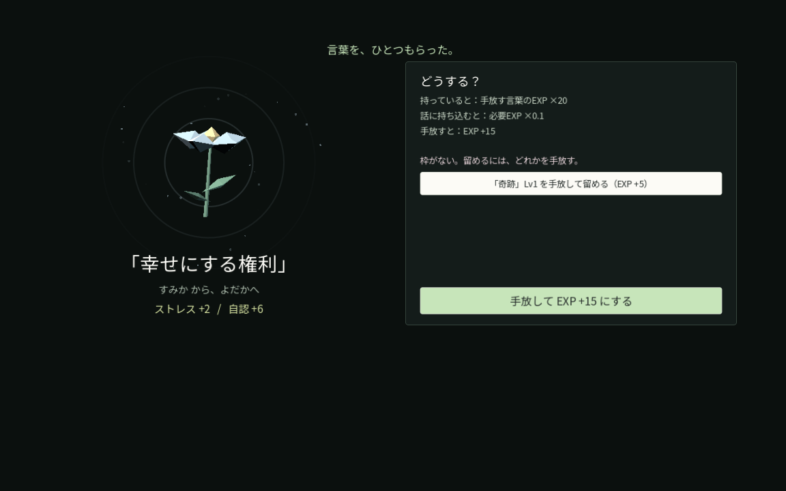

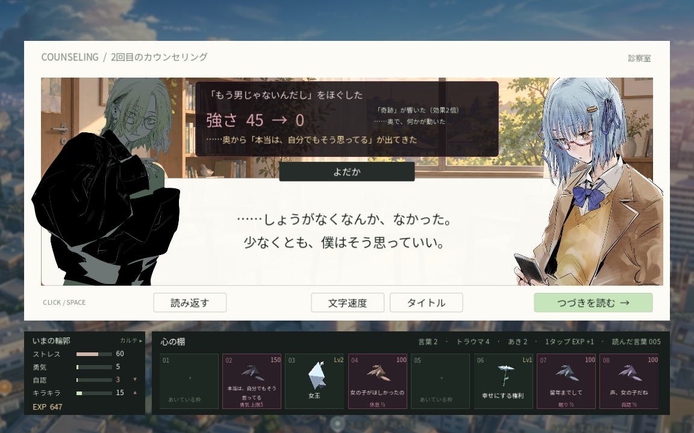

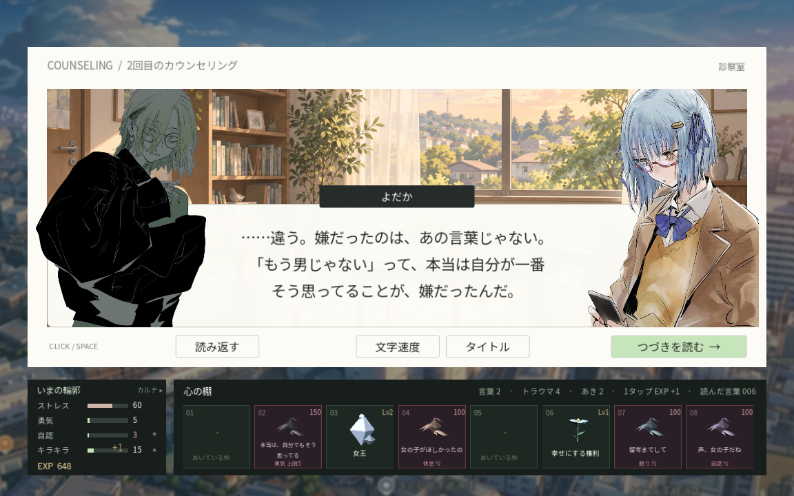

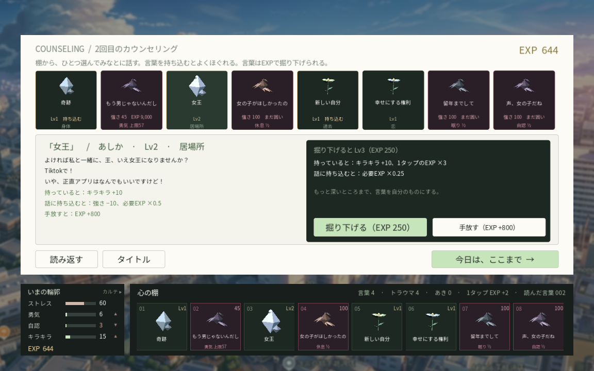

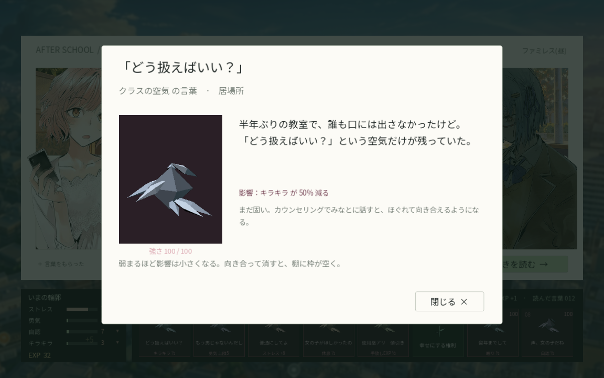

## 2026-09-29 ことばの地図・6語に整理・初期値の変更

- 追記：ストレスの初期値を60に変更。pytest 4件・Godot 4,551チェック成功、Chromium 通しプレイ（自由行動12回・夜16回、最終ストレス49）完走、実行時エラー0件。

- `make lint` 成功。`make test` はpytest 4件、Godot 4,512チェック成功。
- 言葉を6語に整理（削除：えらい・無駄じゃなかった・法月さんのせいじゃない・キラキラ・かわいい）。寿司・なきごえは気づき付きの行き先として残し、気づきの変動幅は全て±1。初期値 `[70, 5, 5, 5]`、勇気の必要値15（14で拒否・15で通過を確認）。
- カルテの「ことばの地図」：言葉ごとに色つきの光が広がり（結晶で拡大）、中心とつながる。忘れた言葉は燠火、未出会いの言葉は暗い点。シード保存で4語＋忘却1語の描画を確認。
- 3方針の通しプレイ：残った言葉1〜5語、忘れた言葉0〜4語、休息0〜2回。ストレス初期70のため序盤に休息が必要になる方針がある。
- Chromium（Playwright、`build/web` をローカル配信）で通しプレイを完走：自由行動12回・夜16回・見つめ16回、残った言葉1語・忘れた言葉3語。最終ステータス [49, 55, 24, 18]。実行時エラー0件。

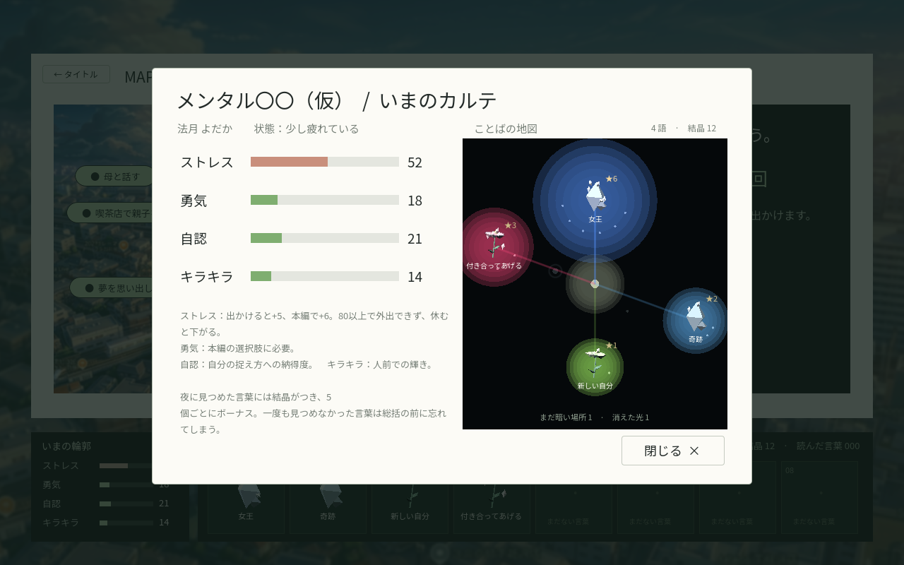

## 2026-09-29 夜の効果±1・結晶5個ボーナス・忘却は未見の言葉だけ

- `make lint` 成功。`make test` はpytest 4件、Godot 4,656チェック成功。
- 夜の成長が各指標±1に収まり、5個目の結晶で受け取り方の表を最大8に拡大したボーナスが乗ること（記録の `bonus` フラグ、予告と適用の一致）を検証。総括で未成長の言葉に答える時は元の表をそのまま使用。
- 一度も見つめなかった言葉だけが忘却されること、5個目のボーナスで勇気が+8前後動くこと、保存復元を確認。3方針の通しプレイは残った言葉1〜8語・忘れた言葉3〜8語。
- Chromium（Playwright、`build/web` をローカル配信）で通しプレイを完走：自由行動12回・夜16回・見つめ16回、残った言葉1語・忘れた言葉7語（自動操作は毎晩同じ言葉を選ぶため）。最終ステータス [22, 96, 68, 58]。実行時エラー0件。
- 拾える言葉と気づきの一覧を `docs/words.md` に出力。

## 2026-09-29 ピンのMAP・結晶・忘却・夜の導入・派手なメーター

- `make lint` 成功。`make test` はpytest 4件、Godot 4,515チェック成功。
- MAPは行ける場所だけをピンで表示（第1週は6か所＋家で休む）。解放前・訪問済みの場所は表示されず、ストレス80以上では「家で休む」だけが残ることを確認。左上の小さな「← タイトル」以外のボタンは無し。カルテは「いまの輪郭」パネルから開く。
- 夜は集めた全ての言葉を選べ、見つめるたびに結晶が1つ増える（2回目以降の効果は半分）。夜の導入で背景が暗くなる演出のクリック必須、再描画しても導入が続くこと、次の夜に再び出ることを確認。
- 総括へ向かう眠りで結晶4個未満の言葉が `forgotten` に移り、忘却画面（Spaceでは進まない）を経てカウンセリングへ。残った言葉は全て「育てた返答」として語られ、問いは発生しない。保存復元も確認。
- 3方針の通しプレイ：残った言葉 0〜2語、忘れた言葉 6〜11語、休息 0〜3回。
- Chromium（Playwright、`build/web` をローカル配信）で通しプレイを完走：自由行動12回・夜16回・見つめ16回、残った言葉1語・忘れた言葉7語、結果画面まで到達。訪問先 ['cafe', 'hands', 'cover', 'park', 'parent', 'chime', 'unicorn', 'bridge', 'dream', 'karaoke', 'native', 'sushi']。最終ステータス [24, 100, 68, 58]。実行時エラー0件。
- 「２本のマイバチがあれば」「楽しくなければテレビじゃないのだ」を行き先から外し、言葉は11種類に。

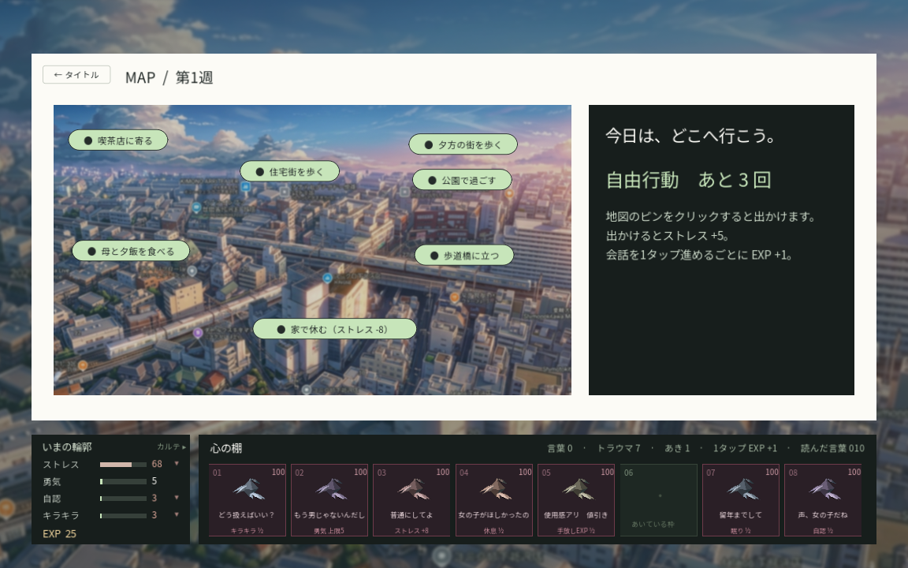

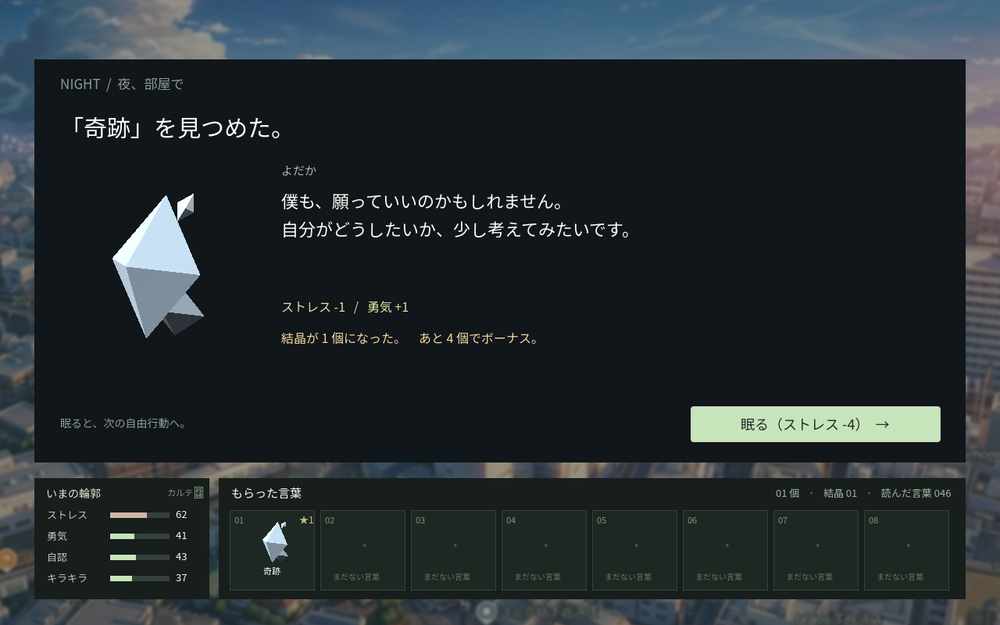

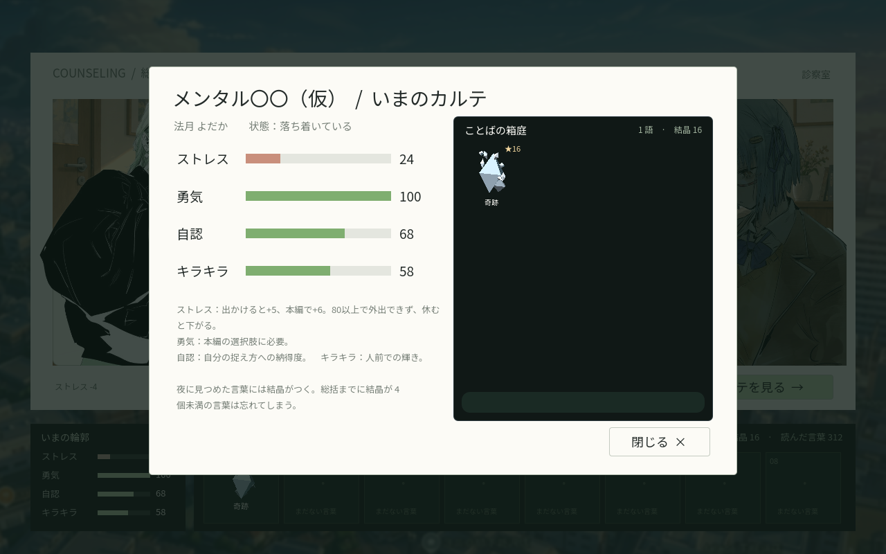

## 2026-09-25 断片集の全17編をMAPに追加

- `make lint` 成功。`make test` はpytest 4件・カバレッジ98%台、Godot 4,233チェック成功。
- 断片集1（10編）・断片集2（7編）の全シートが夜に到達し、言葉のある7編（えらい・奇跡・幸せにする権利・かわいい・あす、あす・付き合ってあげる・宇宙の破滅）と、気づきの効果を持つ独白10編を区別して検証。全379ノードが到達可能。
- 週ごとの解放（第1週7か所、第2週+5、第3週+5）、各週3回・計12回の寄り道、3方針の通しプレイ（取得8〜13語、休息0〜2回）を検証。
- Chromium（Playwright、`build/web` をローカル配信）で通しプレイを完走：寄り道12回・夜16回・育てた言葉6語・取得8語、本編4章、カルテ2回、総括を経て結果画面へ。訪問先 ['cafe', 'hands', 'cover', 'park', 'parent', 'chime', 'unicorn', 'bridge', 'dream', 'karaoke', 'native', 'sushi']。最終ステータス [23, 86, 78, 77]。実行時エラー0件。
- 夜の「眠る」ボタンとMAPの「タイトル」ボタンが重なっていたため、MAP側を上に移動（連続クリックでタイトルへ飛ばない）。

## 2026-09-25 プロトの流れの変更（カウンセリング → 寄り道 → 夜 → 本編 → 総括）

- `make lint` 成功（Ruff、Godot 4.6.2の読み込み）。`make test` はpytest 4件・カバレッジ98.31%、Godot 3,581チェック成功。
- 冒頭カウンセリングの3択×3＝27通りがすべてMAPに到達。台本の「選択肢」「〜を選択」「選択肢差分終了」から分岐を構築し、各選択の効果が4指標の範囲内であることを確認。
- 本編4章（1・3・2・2ルート）と寄り道6種がすべて夜に到達し、全289ノードが到達可能。寄り道ごとの取得語（寿司：えらい、喫茶店：奇跡、すみか：幸せにする権利、母と話す：かわいい、公園・休息：なし）を確認。
- 3方針の通しプレイで、寄り道6回・本編4章の順序、毎晩1語だけ育つこと、育てた言葉は総括で聞かれないこと、未成長の言葉だけ総括で選ぶことを検証。
- 言葉の取得・チュートリアルの選択・休息で、その場でパラメータが動き、差分が記録されることを確認。予告と適用の一致、1回最大2項目、0〜100の範囲を検証。
- 週による行き先の解放、訪問済みの無効化、ストレス80以上での外出制限と休息の許可、勇気59で拒否・60で「お姫様じゃなくてもいい」へ進行を確認。
- 保存形式v4の復元、旧形式（v3）と壊れた保存の拒否、夜・総括の途中からの再開を検証。
- 実UIで4本のバー、みなとの立ち絵、チュートリアル選択の効果予告、カルテの表示と閉じるまで進まないこと、取得暗転での増減表示、MAPの有効ボタン数（3か所＋休息）、夜の成長予告と1晩1語の制限、総括の順序（回想→育てた返答→受け止め／問い→選択→返答→受け止め→カルテ→結び）を確認。
- 台本・回想・返答・総括の全文が本文領域に収まることを検証。
- Chromium（Playwright、`build/web` をローカル配信）で通しプレイを完走：寄り道6回・夜10回・夜に育てた言葉8語・取得10語、本編4章、カルテ2回、総括で残りの言葉を回答して結果画面へ。再読み込み後の「つづきから」で結果画面を復元。最終ステータス [0, 82, 76, 85]。
- 同じブラウザでIndexedDBの実データを差し替え、取得暗転のクリック必須と増減表示、チュートリアル選択の効果（自然に → 自認+4）、ストレス80での外出制限と休息の選択、勇気59/60の分岐制御、総括の回答と返答の保存を確認。JavaScript / Godot実行時エラー0件。
- 844×390の横長画面で全体表示を確認。実機スマートフォン・Safariは未検証。GitHub Pages [公開処理36175062531](https://github.com/xemonodesign/godot-novel-yodaka/actions/runs/36175062531) 成功（gh-pages 01263dc、この検証と同じビルド）。公開URLはこの作業環境から到達できないため、配信物の一致は未確認。

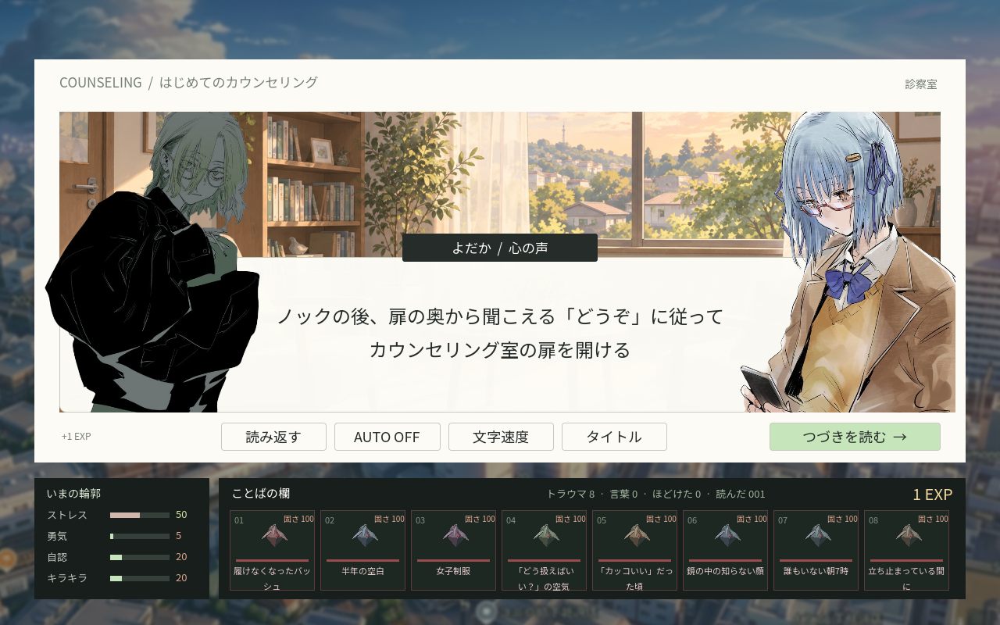

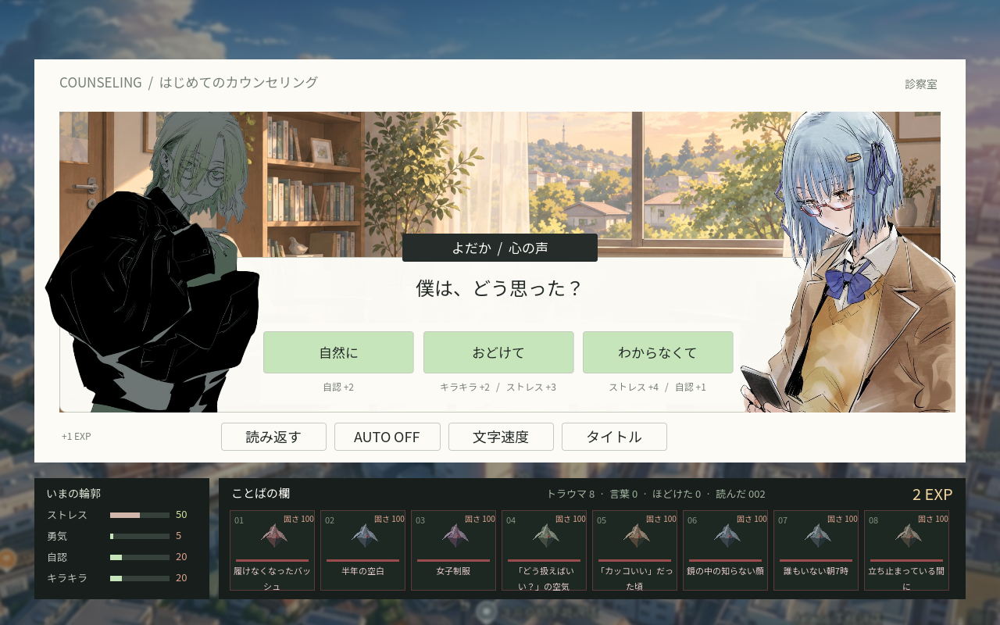

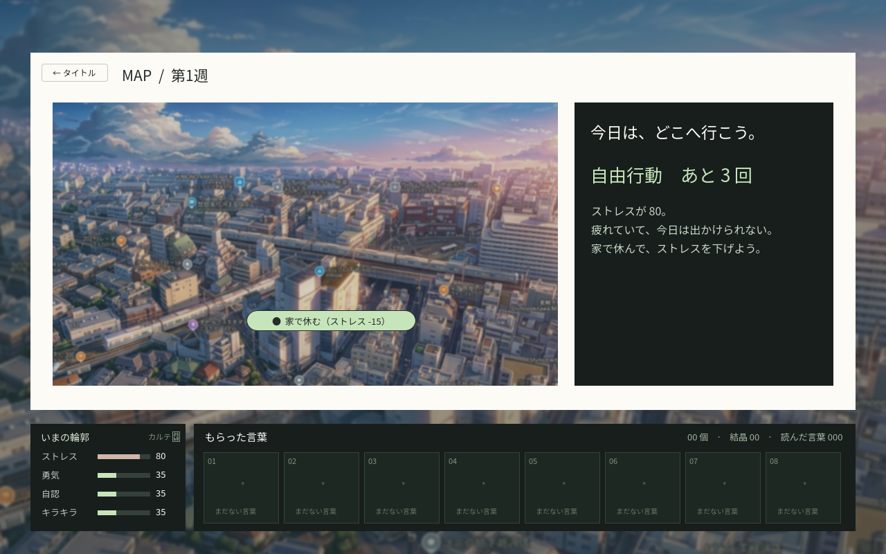

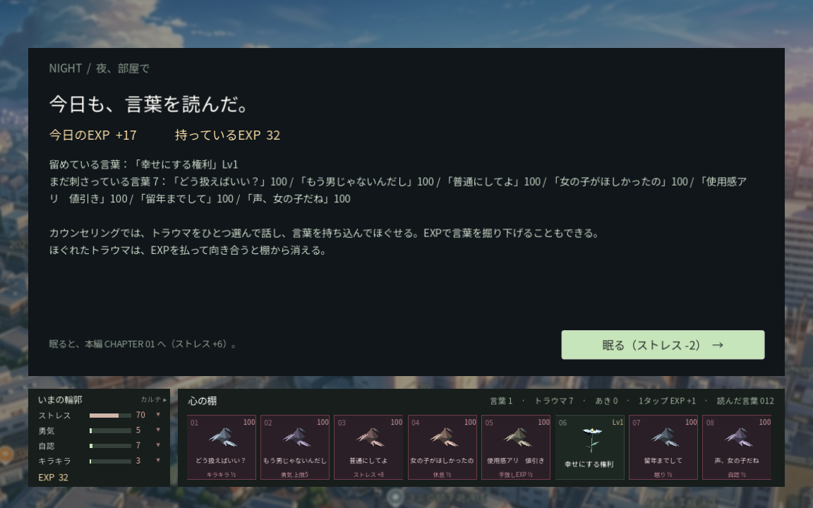

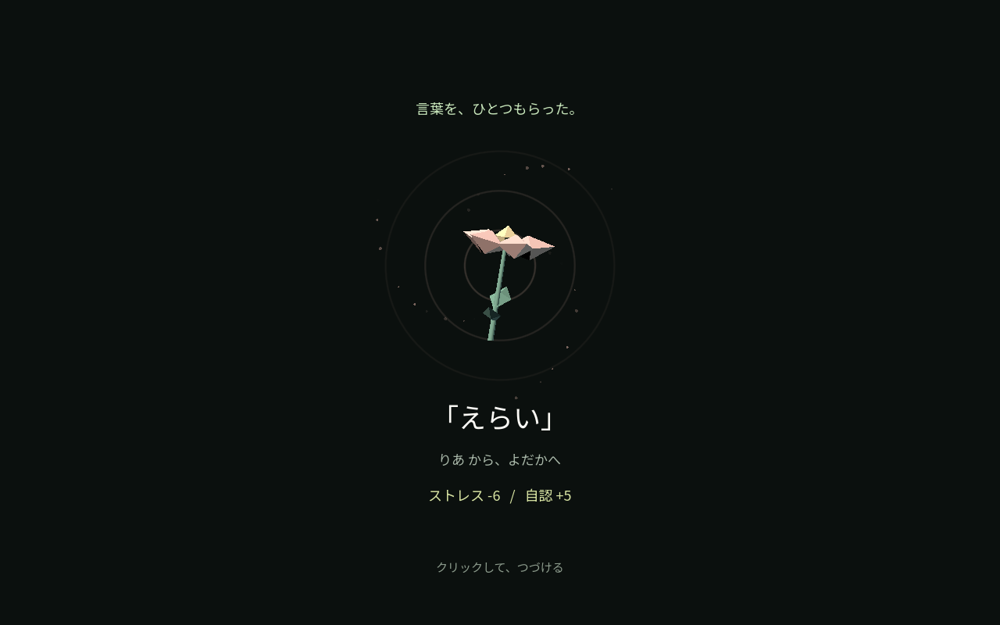

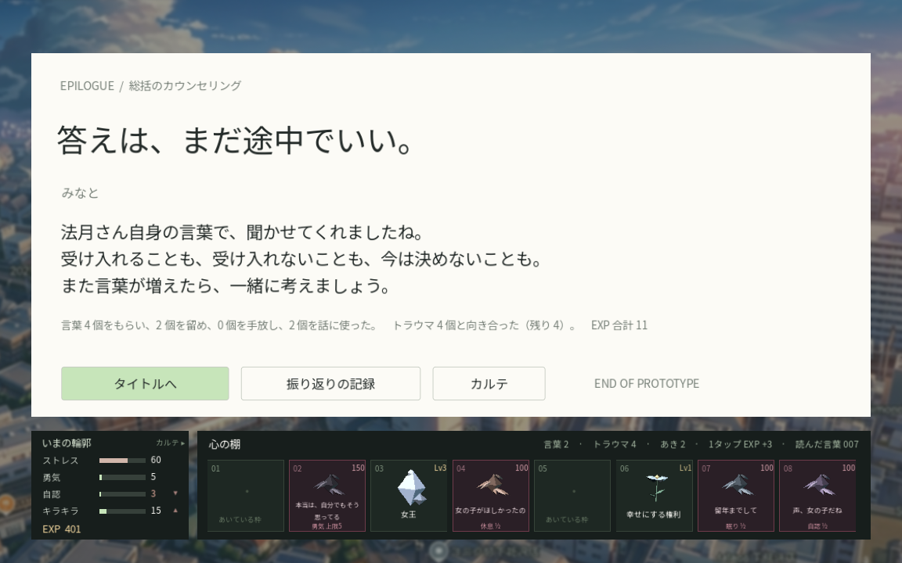

## 2026-09-10 MAP・勇気分岐・背景の更新

- `make lint` 成功。`make test` はpytest 2件・カバレッジ98.97%、Godot 2,722チェック成功。
- MAPの3イベントを含む全36ルートが中間カウンセリングを経てCHAPTER 6に進み、最後のカウンセリングまで到達。
- 1周の収集数は公園8語、母・喫茶店9語。イベントの二重選択、言葉の重複収集・再回答を防止。
- 勇気54で選択を拒否、55で「お姫様じゃなくてもいい」へ進行。UIの無効化も確認。
- カウンセリングによる勇気の上昇、中間・最後それぞれの帰り先、保存復元を検証。
- 左右の立ち絵のサイズ・縦位置・会話枠より手前の描画順、本文の画面中央配置、母・すみかの表示を検証。
- 台本・回想・返答の全文が本文領域に収まることを検証。
- ChromeでMAP経由の通しプレイ・8語8回答・結果・再開を確認。母・すみか・喫茶店の描画、勇気54/55の選択制御、返信の保存復元も実際のIndexedDBで確認。実行時エラー0件。
- 素材の透明余白を除き、全身素材を上半身に収める表示処理で立ち絵の見た目の高さを統一。

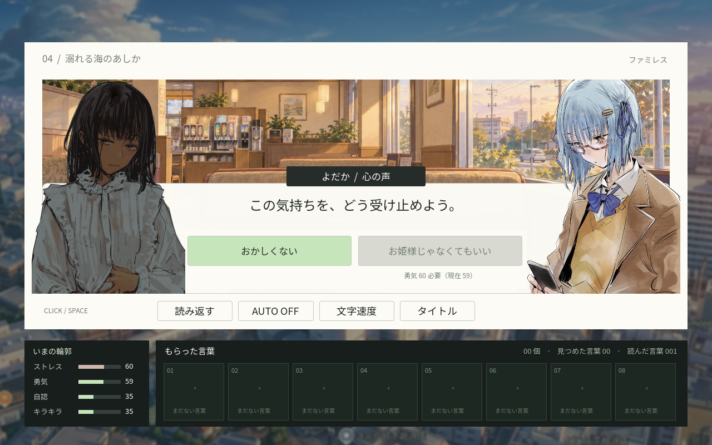

- 公開URLで同じChrome検証を完走。MAP選択・8語8回答・エンディング・勇気54/55の制御・返信からの再開に成功。実行時エラー0件。
- GitHub Pages [公開処理34457593226](https://github.com/xemonodesign/godot-novel-yodaka/actions/runs/34457593226) 成功。配信中のPCK（26,293,828 bytes）がローカルリリースとSHA-256で一致。

## 2026-09-09 演出・会話の更新

- `make lint` 成功。`make test` はpytest 2件・カバレッジ98.85%、Godot 1,938チェック成功。
- 24種類の解釈で変動が最大2項目に収まること、予告と適用が一致することを確認。
- 章・場所の暗転、取得演出のクリック必須、AUTO停止、Space/Escapeで飛ばないことを確認。
- 話者の明暗、よだかを右の会話枠の手前へ表示する順序を検証。
- 元の全台詞・追加の回想と返答256件が、中央揃えの本文領域に収まることを検証。
- 旧セーブ形式v1の読み込みと、取得演出・よだかの返答の途中から再開する保存形式v2を検証。
- Chromeで通しプレイし、8個の言葉、8回の回答、エンディング、再読み込みからの再開を確認。
- `tests/browser_smoke.cjs` で実際のIndexedDB保存内容も検証。JavaScript / Godot実行時エラー0件。

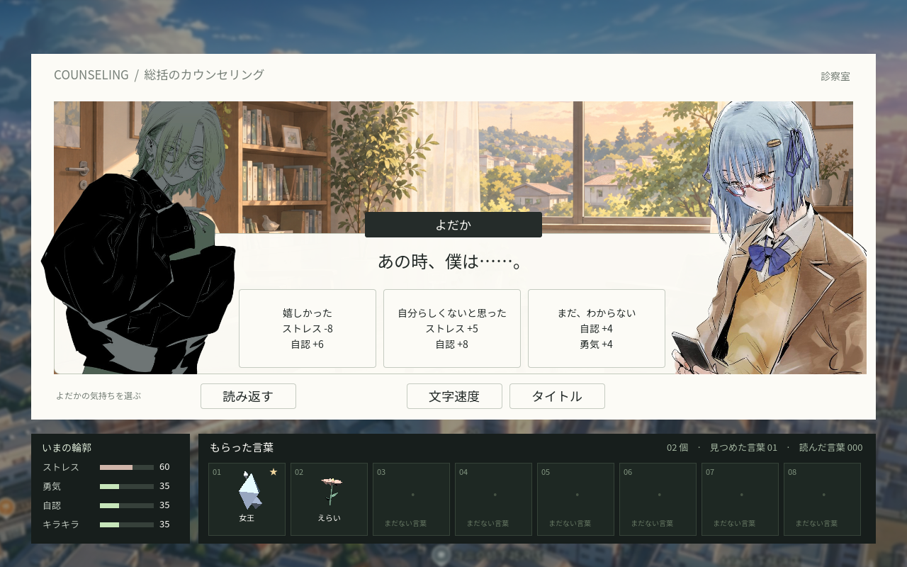

## 2026-09-08 初版

2026-09-08、Godot 4.6.2 / macOS / Chrome（Playwrightによる実ブラウザ操作）で確認。

- `make lint`: RuffとGodotの読み込みが成功。
- `make test`: pytest 2件成功。インポーターのカバレッジ98.85%。全12シナリオルートの到達性・分岐排他・8語の到達を確認。
- Godotランタイム検証: 1,583チェック成功。3種の解釈、上下限、保存復元、重複収集防止、二重回答防止、実UIの文字送り・モーダル・終了画面を確認。
- `make web`: 非スレッドのWebリリースビルド成功。
- GitHub Pages公開処理: [実行34229580900](https://github.com/xemonodesign/godot-novel-yodaka/actions/runs/34229580900) 成功。公開URL HTTP 200。
- 公開URLをChromeで読み込み、クリック操作で冒頭からエンディングまで通過。8語の収集と8回答を実際のIndexedDB保存データでも確認。JavaScript / Godotの実行時エラー0件。
- 公開URLを再読み込み →「つづきから」→ 結果画面の復元を確認。
- 標本をクリックして元の発言と解釈を閲覧し、Escapeで閉じられることを確認。
- 1280×800、および844×390の横長画面で画面全体の表示を確認。実機スマートフォン・Safariは未検証。

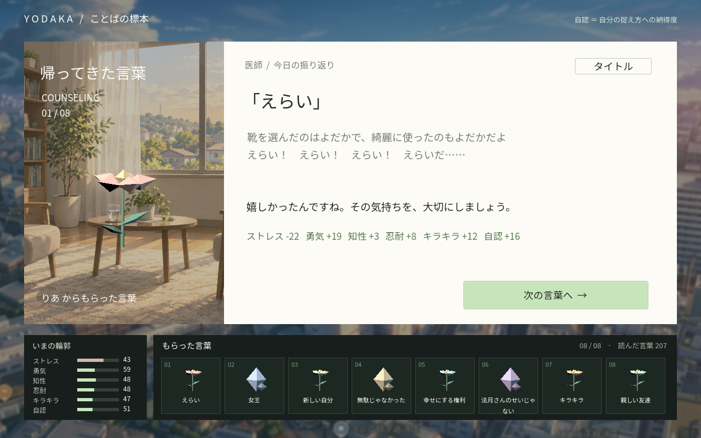

